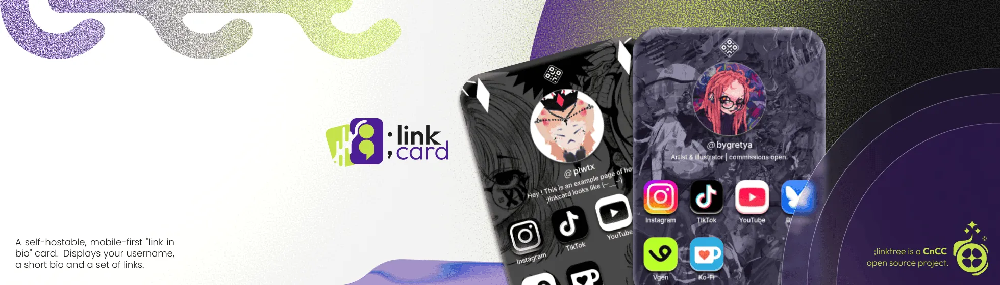

# ;linkcard

A self-hostable, mobile-first "link in bio" page styled as a flippable card. It shows your username, a short bio, a set of links as apps, a side that flips to reveal a sharable QR code, and a portfolio link in the footer. Think of it as a personal alternative to Linktree that you own and host yourself.

> <!-- **Live demo:** https://**ILL ADD THIS ONCE I HAVE DOMAIN**-->

## Features

- Mobile first and responsive across all screen sizes.
- Physical card look with a flip animation, device tilt, and touch gestures.
- Sharable QR code that always points to wherever the page is hosted.
- Animated background tiles that flip into place on load.
- Two built in icon styles for link tiles (`default` and `1bit`) (I will add more in future ( ᵔ ⩊ ᵔ ) ).
- All page content lives in a single JSON file, so no code changes are needed for normal edits.
- Page title, description, theme color, and link preview tags (Open Graph and Twitter) are generated automatically from your config at build time.
- Blocks **AI bots, crawlers and scrapers**\*

```
* Blocks major crawlers (Google, Bing, GPTBot, ClaudeBot, etc.),
but only those that choose to respect it. Non-compliant or niche bots can
ignore it entirely. Full enforcement requires server-level controls, which
aren't available in a static project like this one.
```

## Tech stack

React 19, TypeScript, Vite, Tailwind v4, Motion, and Lucide icons. There is no backend; the output is a static site you can host anywhere.

## Quick start

Prerequisites: Node.js (version 20.19 or newer, or 22.12 or newer) and npm.

```bash
git clone https://github.com/plwtx/linkcard
cd linkcard
npm install
npm run dev
```

The dev server runs at http://localhost:3333. (•⩊•)

## Configuring your content

Everything you normally change lives in [`src/assets/json/config.json`](src/assets/json/config.json). You do not need to touch any code to update your page. Every field is optional except `links`, which can be an empty array if you want no tiles.

##### Example:

```json
{
  "username": "plwtx",
  "description": "Artist & illustrator | commissions open.",
  "accentColor": "#4c1d95",
  "linkStyle": "default",
  "website": {
    "label": "0w0.lt",
    "url": "https://0w0.lt/"
  },
  "links": [
    { "label": "Instagram", "url": "https://www.instagram.com/plwtx" },
    { "label": "Ko-Fi", "url": "https://ko-fi.com/plwtx/commissions" }
  ]
}
```

What each field does:

| Field         | Type              | What it controls                                                                                              |
| ------------- | ----------------- | ------------------------------------------------------------------------------------------------------------- |
| `username`    | string            | Shown on the card as `@username`. Also used in the page title and the meta tags.                              |
| `description` | string (optional) | The short bio line shown under your username. Leave it out to hide it.                                        |
| `accentColor` | hex string        | Drives the glowing background blobs and the browser `theme-color`. Use any hex value, for example `#c4e24a`.  |
| `linkStyle`   | string            | Which icon set the link tiles use. Built in values are `default` and `1bit` (see below).                      |
| `website`     | object (optional) | A portfolio link shown in the footer as `{ "label": ..., "url": ... }`. Leave it out to hide the footer link. |
| `links`       | array             | The link tiles, in order. Each entry is `{ "label": ..., "url": ... }`.                                       |

### Links and their icons

Each link is `{ "label": "...", "url": "..." }`. The `label` does double duty: it is the text under the tile, and its lowercased form is the icon name. The chosen `linkStyle` then decides which icon folder is used.

For example, a link with `"label": "Instagram"` and `"linkStyle": "default"` looks for `src/assets/icons/default/instagram.webp`. A label of `"Ko-Fi"` maps to `ko-fi.webp`.

Icons that ship with the project (available in both styles) are:

`bluesky`, `instagram`, `ko-fi`, `tiktok`, `vgen`, `youtube`.

If a link's label has no matching icon file, the tile falls back to a plain dark box with a generic link glyph, so unknown links still work.

To add your own icon for a new service:

1. Add the link to `links` in the config, for example `{ "label": "Discord", "url": "https://discord.gg/..." }`.
2. Create a `.webp` icon named after the lowercased label, for example `discord.webp`.
3. Place it in the icon folder that matches your `linkStyle`. To support both styles, add it to `src/assets/icons/default/` and `src/assets/icons/1bit/`.

## Replacing the images

The card art and profile picture live in [`src/assets/images/`](src/assets/images/). Replace these files with your own, keeping the same file names so the imports keep working. WebP is recommended for size and quality.

| File                   | What it is                            | Suggested size                                  |
| ---------------------- | ------------------------------------- | ----------------------------------------------- |
| `profile-picture.webp` | The round avatar on the card front.   | Square, around 400 x 400.                       |
| `card-front.webp`      | Background of the front of the card.  | Portrait, around 744 x 1040 (3:4).              |
| `card-back.webp`       | Background shown when the card flips. | Same as the front.                              |
| `card-qr.webp`         | Background behind the QR code view.   | Same as the front.                              |
| `bg_tile.webp`         | The repeating page background tile.   | Small seamless square (the default is 99 x 99). |
| `left-art.webp`        | Decorative art on the left side.      | Transparent PNG or WebP.                        |
| `right-art.webp`       | Decorative art on the right side.     | Transparent PNG or WebP.                        |

The favicon is [`public/favicon.svg`](public/favicon.svg). Replace it with your own SVG to change the browser tab icon.

The QR code encodes the page's own address at runtime, so you do not need to configure it. Once deployed, scanning the code opens your live page.

## Building for production

```bash
npm run build     # type-check, then build into dist/
npm run preview   # serve the built site locally to verify it
```

The build output is a static site in the `dist/` folder. The page title and all meta tags are filled in from your config during this step.

## Deploying to your own domain

Because the build is a plain static site, you can host the contents of `dist/` on any static host. Two common paths:

**Managed hosts (Vercel, Netlify, Cloudflare Pages):**

1. Push your fork to GitHub and connect the repository in the host's dashboard.
2. Set the build command to `npm run build` and the output directory to `dist`.
3. After the first deploy, open the host's domain settings, add your custom domain, and follow their instructions to update your DNS records (usually a `CNAME` or an `A` record at your registrar).

**GitHub Pages:**

1. Run `npm run build` and publish the `dist/` folder (for example with the Pages action or by pushing it to a `gh-pages` branch).
2. If you deploy to a project page such as `username.github.io/linkcard/`, set the base path so assets resolve correctly. In [`vite.config.ts`](vite.config.ts) add `base: "/linkcard/"` to the config, then rebuild. If you use a custom domain or a user page (`username.github.io`), the default root base is fine and no change is needed.

After your site is live on your domain, rebuild once so the QR code and meta tags reflect the final address, then redeploy.

## Available scripts

| Script            | What it does                                           |
| ----------------- | ------------------------------------------------------ |
| `npm run dev`     | Start the dev server at http://localhost:3333.         |
| `npm run build`   | Type-check and build the production site into `dist/`. |
| `npm run preview` | Preview the production build locally.                  |
| `npm run lint`    | Run ESLint over the project.                           |

## License

This project is licensed under the GNU Affero General Public License v3.0 (AGPL-3.0). See the [LICENSE](LICENSE) file for the full text.

This means:

- You are free to use, modify, and distribute this software.
- Any modifications or derivative works must also be released under AGPL-3.0.
- If you run this software as a network service, you **must** make the complete source code available to users.

For full license details, see the [LICENSE](./LICENSE) file or visit https://www.gnu.org/licenses/agpl-3.0.html.

###### THIS APP & DEVELOPER(s) DOES NOT PERMIT ANY (AI) AGENTS / CRAWLERS / BOTS / ANYONE USE OF IT'S DATA, CODE OR ANY RELATED INFORMATION FOR ANY PURPOSES OTHER THAN IT'S INITIAL PURPOSE (WHICH IS LISTED IN LICENSE) OF THE APP. USE OF THIS SOFTWARE OR ANY DERIVATIVE TO TRAIN MACHINE LEARNING MODELS OR PRIVATE CLOSED SOURCE SOFTWARE IS FORBIDDEN.

Copyright (C) 2026 plwtx.
